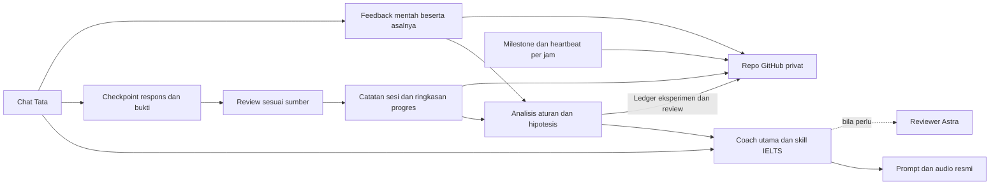

# Sistem IELTS Coach Tata

Tujuan program adalah melatih **keempat skill untuk overall 6.5**, dengan target kerja sementara tiap skill 6.0. Syarat kampus dan jalur LPDP perlu diperiksa dari sumber resmi setelah tujuan diketahui; target sementara ini belum menjadi syarat pendaftaran. Skor lama milik Tata adalah laporan pengguna. Belum ada baseline baru yang memadai.

## Coach, subagent dan skill

Tata berinteraksi dengan **satu coach utama dalam chat**. Coach memilih tugas, memeriksa sumber, menyimpan respons dan menjelaskan hasil. **Satu reviewer Astra dipanggil sesuai kebutuhan**: perubahan sistem, sengketa penilaian yang sulit, bukti yang saling bertentangan, atau review checkpoint penting. Astra memberi second opinion; keputusan tetap harus mengikuti sumber dan bukti. Sistem tidak memerlukan banyak agent aktif pada setiap sesi.

| Bagian | Jumlah dan peran |
| --- | --- |
| Alur belajar rutin | 1 coach utama; 1 reviewer Astra sesuai kebutuhan |
| Pengerjaan penambahan adaptasi pada 12 Oktober 2026 | 3 subagent: implementasi modul, dokumentasi/sinkronisasi, dan review Astra; coordinator utama menggabungkan hasil |
| Pengerjaan v1.1 sebelumnya | 4 subagent termasuk penyiapan referensi; ini riwayat pengerjaan, bukan 4 agent yang wajib hidup saat Tata belajar |
| Skill khusus project | 2: `ielts-coach` untuk coaching dan `ielts-github-sync` untuk backup milestone/hourly; keduanya ikut repo |
| Skill pendukung pengerjaan | OpenAI Docs, Skill Creator dan PDF digunakan sesuai pekerjaan; bukan tiga coach tambahan dan tidak wajib pada tiap sesi |
| Modul Python | 6: workflow coach, catatan sesi, Git, pemeriksaan referensi, adaptasi, dan runner backup hourly |
| Materi awal | 8 cuplikan resmi; 4 cache koreksi Listening/Reading. Bank ini belum menyediakan tes lengkap keempat skill |

Skill coaching menjadi pintu masuk workflow; skill backup merujuk runner/sinkronisasi yang aman dan izin pengguna. Aturan utamanya tetap di `AGENTS.md`; skill tidak menyimpan salinan kebijakan yang berubah sendiri. Repo-local skills dapat ikut repo pada `.agents/skills/`, dengan `SKILL.md` dan metadata opsional; periksa deteksinya pada setiap laptop. [Panduan skills OpenAI](https://learn.chatgpt.com/docs/build-skills), [contoh repo-local OpenAI](https://developers.openai.com/blog/skills-agents-sdk).

## Alur belajar dan data

1. **Mulai/lanjut:** periksa sinkronisasi, profil, rencana, sesi aktif dan konteks adaptasi. Sambung ID yang ada atau berikan tepat satu tugas baru yang muat dalam waktu Tata; default 20 menit. Coach memeriksa sumber dan kesiapan fitur yang relevan, kemudian memberikan prompt/audio tanpa jawaban.
2. **Respons:** simpan checkpoint segera setelah jawaban, screenshot, rekaman atau kondisi tersedia. Simpan respons pertama; revisi setelah feedback menjadi record terpisah. Tata menekan Play sendiri.
3. **Done:** nilai hanya bukti yang tersedia terhadap versi sumber yang sama. Bukti tidak cukup membuat sesi menunggu bukti/review. Feedback memuat skor dengan status bukti, satu kekuatan, maksimal dua pola, satu tindakan, dan satu tugas berikutnya.
4. **Simpan dan sinkronkan:** baca ulang record dan ringkasan; otomatis coba push pada milestone. Hasil lokal tetap tersimpan jika push gagal. Retry memulihkan ringkasan/sinkronisasi tanpa menilai ulang atau membuat attempt baru. Heartbeat per jam memeriksa backup data tersimpan pada laptop aktif.
5. **Sesuaikan:** simpan feedback eksplisit sebagai event mentah, analisis catatan yang layak, lalu beri coach rekomendasi beserta input ID dan versi aturan. Coach menyiapkan satu tugas berikutnya beserta cadangan, mengikuti L–R–S–W sambil menyesuaikan dari bukti. Tata tidak perlu mengisi formulir tambahan atau menjalankan Git.

`sessions/` menyimpan attempt; `evidence/` menyimpan bukti yang tersedia. `feedback/` menyimpan masukan mentah dan pemeriksaan sengketanya. `learning/` menyimpan ledger eksperimen/review; analisis preferensi dan pola dihitung ulang dari input mentah, dengan versi aturan serta ID sumber pada output. `PROGRESS.md` serta `STATUS.md` menjadi ringkasan. `.local/` menyimpan kesiapan perangkat dan cache sementara, sehingga keberhasilan perangkat lama tidak terbawa sebagai fakta pada laptop baru.

## Bagaimana sistem membaik

Adaptasi menggunakan **catatan dan aturan yang bisa diperiksa**, bukan melatih ulang model. Preferensi eksplisit Tata tentang waktu atau panjang feedback dapat langsung dipakai dalam scope yang diminta. Dua attempt baru terverifikasi dengan pola yang sama hanya membentuk **hipotesis**, lalu satu drill dan pemeriksaan transfer dengan soal baru. Skor total saja tidak mendukung dugaan kesalahan per soal. Retake setelah key, tes sistem, latihan dengan bantuan, dan penilaian yang disengketakan tidak dipakai sebagai bukti perkembangan kemampuan.

Perubahan alur yang lebih besar diuji sebagai eksperimen dengan hipotesis, perubahan kecil, ukuran hasil, baseline, serta bukti outcome yang sebanding. Keputusan boleh **bukti belum cukup**; tidak harus dinyatakan berhasil. Analisis tidak otomatis mengganti target, aturan project, jawaban, atau skor. Penilaian yang disengketakan dikeluarkan dari analisis kemampuan sampai sumber diperiksa; data aslinya tetap ada. Prosedur dan antarmuka ada di [ADAPTATION.md](ADAPTATION.md).

Desain ini memakai pengujian kasus nyata, log, dan review manusia untuk memeriksa perubahan. Prinsip tersebut sejalan dengan panduan eval OpenAI; aturan dua attempt dan kebijakan band konservatif adalah pilihan program ini, bukan standar resmi yang menjamin kenaikan IELTS. [Evaluation best practices OpenAI](https://developers.openai.com/api/docs/guides/evaluation-best-practices).

## Dua pemeriksaan yang terpisah

| Pemeriksaan | Bukti yang diperlukan | Keadaan yang diketahui pada 12 Oktober 2026 |
| --- | --- | --- |
| Operasional | Respons tersimpan/resume, file/cache utuh, playback aset yang dipakai, screenshot, rekaman, dan sinkronisasi aktual | Kontrol suara sintetis dan resume chat baru telah diperiksa. Screenshot serta rekaman pengguna masih menunggu; audio Listening resmi belum dibuktikan diputar. Lihat status perangkat aktual sebelum tugas |
| Pedagogis | Diagnostik baru keempat skill dengan sumber dan kondisi cukup, lalu checkpoint memakai soal baru | Belum tersedia. Trial tiga soal dan rehearsal adalah tes sistem; tidak membuktikan baseline atau peningkatan band |

Tes otomatis memeriksa perlindungan data, validasi dan aturan adaptasi; tes tidak membuktikan Tata dapat memakai setiap fitur atau telah meningkat kemampuannya. Pengujian v1.1 sebelum penambahan adaptasi tercatat 96 tes otomatis; hasil penambahan dan verifikasi aktual dilaporkan pada `IMPLEMENTATION_REPORT.md`. Pengguna telah mengizinkan backup/publikasi milestone sebelum rehearsal lengkap. Publikasi Git tidak membuat screenshot/rekaman atau baseline yang masih menunggu menjadi lulus; klaim terbit tetap memerlukan push serta pemeriksaan remote.

## Backup milestone dan per jam

Autosync berjalan sesudah checkpoint, hasil dan feedback tersimpan serta dibaca ulang, dan setelah materi/pembaruan sistem diverifikasi. Heartbeat Codex **setiap 1 jam** menjadi pemeriksaan tambahan pada laptop aktif ketika aplikasi tersedia. Runner `scripts/hourly_sync.py` memvalidasi catatan sesi, feedback serta cache koreksi, lalu menggunakan sinkronisasi aman ke `octhariaus-tata/ielts-coach-tata`, branch `main`. Autentikasi yang sudah tersedia cukup untuk push dalam izin ini; tidak perlu persetujuan baru setiap run.

Session lock menjaga pencatatan lokal; Git lock menserialkan operasi milestone dan hourly. Jika writer sedang sibuk, runner dapat menunda hingga run berikutnya, mempertahankan respons dan ID. Bila versi bercabang, perubahan lokal berbenturan dengan remote lebih baru, credential gagal, atau pemeriksaan data gagal, data dipertahankan dan coach menangani penyebabnya. Runner tidak memakai reset/force-push, mengubah credential/config, membuka soal, memutar audio, atau menilai ulang.

Status run ada pada `.local/scheduled-sync.json` dan tidak ikut Git. Run rutin sukses/tanpa perubahan atau penundaan karena writer sibuk tetap diam; notifikasi hanya untuk kegagalan atau kebutuhan tindakan yang baru/berubah. Keadaan yang sama tidak diulang setiap jam. Laptop tidur, Codex tidak tersedia atau jaringan offline dapat menunda run/backup; status remote aktual tetap diperiksa sebelum pindah laptop. Heartbeat tidak memindahkan folder laptop lain melalui akun Codex. Setiap laptop tetap memerlukan clone serta akses GitHub, dengan satu perangkat belajar aktif pada satu waktu.

## Bertumbuh tanpa membebani Tata

Pertahankan satu coach dan catatan per attempt ketika materi serta jumlah sesi bertambah. Tambahkan materi resmi baru ke katalog dengan versi, prompt/audio, sumber koreksi dan provenance; bank awal yang sudah terekspos tidak diulang sebagai pengukuran baru. Ukur masalah konkret sebelum menambah agent atau infrastruktur. GitHub privat tetap menyimpan versi bersama; satu perangkat belajar aktif, OS lock untuk operasi lokal, dan rekonsiliasi menjaga seluruh record bila versi berbeda.

Coaching dan perubahan aturan tetap dikerjakan ketika chat digunakan; heartbeat yang diminta pengguna hanya menangani backup. Tidak ada server API tambahan atau latihan/penilaian otomatis. Automasi lain memerlukan arahan pengguna tersendiri. Login Codex yang sama tetap membutuhkan folder repo dan credential GitHub yang tersedia pada perangkat; setup dan batas pemeriksaannya ada di [SETUP.md](SETUP.md).
